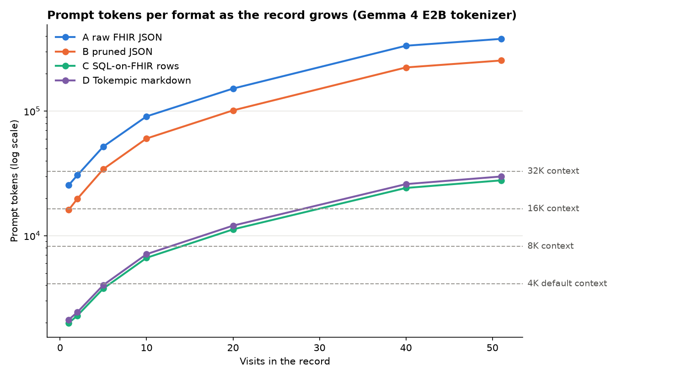

# FHIR via small language models on device

Can a small language model on a phone read a patient's FHIR record? This
folder tests whether turning FHIR JSON into SQL-on-FHIR views and Markdown
([Tokempic](https://github.com/recodelabs/tokempic)) makes the record small
enough to fit. It comes from the OHS issue "Exploration: FHIR via LLMs on
device".

## Key results

From [experiment 1](experiment-1/), with Gemma 4 E2B and one synthetic
patient on an Android emulator (CPU).



| Visits | FHIR resources | Raw JSON tokens | Tokempic tokens |
|---|---|---|---|
| 1 | 47 | 25,486 | 2,116 |
| 10 | 166 | 90,741 | 7,108 |
| 51 | 703 | 380,033 | 29,857 |

- Tokempic is about 12 times smaller than raw JSON. It costs about 42
  tokens per FHIR resource, against about 541.
- Raw JSON does not fit one visit into the model's default context of
  4,096 tokens.
- Memory grows with the context size: about 2.2 GB at 4K, 2.8 GB at 8K,
  3.9 GB at 16K and 6.0 GB at 32K. On an 8 GB phone that means about 10 to
  20 visits with Tokempic.
- 10 visits with Tokempic took 51 seconds in total (7,128 tokens in, 154
  out). 1 visit of raw JSON took 9.4 minutes.

Times are from the emulator and will be faster on a real phone. Token
counts are the same on any device.

## What's here

| Folder | What it is |
|---|---|
| [`slm-runtime/`](slm-runtime/) | Kotlin Multiplatform library that runs a model on device through LiteRT-LM and measures each run |
| [`slm-bench/`](slm-bench/) | Android app that uses `slm-runtime`. You can type a prompt, or start a measured run from `adb` |
| [`experiment-1/`](experiment-1/) | Experiment 1: token savings and scaling. Scripts, data and results |

## Setup

You need:

- JDK 17 or newer
- Android Studio with the Android SDK
- About 3 GB of free disk space for the model
- `adb` on your `PATH`. It is in `platform-tools` in the Android SDK

**1. Download the model.** Gemma 4 E2B for LiteRT-LM, 2.6 GB, no login
needed.

```bash
mkdir -p ~/models
curl -L -o ~/models/gemma-4-E2B-it.litertlm \
  https://huggingface.co/litert-community/gemma-4-E2B-it-litert-lm/resolve/main/gemma-4-E2B-it.litertlm
```

**2. Create an emulator.** We use a Pixel 4 XL with Android 36
(`google_apis`, `arm64-v8a`). The defaults are too small for the model, so
set these in the emulator's `config.ini` (in `~/.android/avd/<name>.avd/`):

```ini
hw.ramSize=8192
disk.dataPartition.size=16G
```

A new data partition size only applies after a cold boot with wiped data.
Start it once with `emulator -avd <name> -wipe-data`.

A real phone works too. It needs at least 8 GB of RAM.

## Run slm-bench

**1. Install the app.**

```bash
cd slm-bench
./gradlew :app:installDebug
```

**2. Copy the model into the app.** The app reads it from its own files
folder, `files/model.litertlm`. A new install has no files folder yet,
so the second command creates it.

```bash
adb push ~/models/gemma-4-E2B-it.litertlm /data/local/tmp/model.litertlm
adb shell run-as dev.ohs.slm.bench mkdir -p files
adb shell run-as dev.ohs.slm.bench cp /data/local/tmp/model.litertlm files/model.litertlm
```

**3. Try a prompt.** Open "SLM Bench" on the device. When the status line
says the model is loaded, type a prompt and tap Send. The reply streams in
with its stats above it.

**4. Start a measured run.** Each run is a cold start of the app, so runs
don't affect each other. The prompt is a file in the app's files folder.

```bash
echo "Say hello in one sentence." > hello.txt
adb push hello.txt /data/local/tmp/hello.txt
adb shell run-as dev.ohs.slm.bench cp /data/local/tmp/hello.txt files/hello.txt
adb logcat -c
adb shell am start -S -n dev.ohs.slm.bench/.MainActivity \
  --es prompt_file hello.txt --ei max_tokens 4096 --es backend cpu
```

| Option | Meaning | Default |
|---|---|---|
| `prompt_file` | Prompt file name in the app's files folder | None. Without it the app waits for a typed prompt |
| `max_tokens` | Context size in tokens, prompt plus reply | The model's default, 4,096 for Gemma 4 E2B |
| `backend` | `cpu` or `gpu`. The GPU needs OpenCL, which the emulator doesn't have | `cpu` |

**5. Read the result.** When the reply ends, the app logs one line with
the tag `SlmBench` and saves the reply as `files/<prompt_file>.reply.txt`.

```bash
adb logcat -d -s SlmBench
adb shell run-as dev.ohs.slm.bench cat files/hello.txt.reply.txt
```

```
prompt=hello.txt backend=cpu max_tokens=4096 load_ms=11116 ttft_ms=1858 prefill_tokens=15 decode_tokens=3 prefill_tps=9.6 decode_tps=3.3 total_ms=2489 first_chunk_ms=2273 chars=6 peak_rss_mb=1564
```

If the run fails, the line has `error=` with the reason instead of the
numbers. For example, a prompt longer than the context gives
`error=Status_Code:_3._Message:_Input_token_ids_are_too_long._Exceeding_the_maximum_number_of_tokens_allowed:_7128_>=_4096`.

[`experiment-1/run_device.sh`](experiment-1/run_device.sh) does steps 4
and 5 in one command.

## Metrics

| Field | Meaning | Measured by |
|---|---|---|
| `prompt` | Prompt file name | The app |
| `backend` | `cpu` or `gpu` | The app |
| `max_tokens` | Context size the engine was created with | The app |
| `load_ms` | Time to load the model | The app |
| `ttft_ms` | Time to first token | LiteRT-LM |
| `prefill_tokens` | Prompt size in tokens, including the chat template (about 9 tokens) | LiteRT-LM |
| `decode_tokens` | Reply size in tokens | LiteRT-LM |
| `prefill_tps` | Prompt reading speed, tokens per second | LiteRT-LM |
| `decode_tps` | Reply writing speed, tokens per second | LiteRT-LM |
| `total_ms` | Time from sending the prompt to the end of the reply | `slm-runtime` |
| `first_chunk_ms` | Time until the first piece of the reply reaches the app | `slm-runtime` |
| `chars` | Reply length in characters | `slm-runtime` |
| `peak_rss_mb` | Peak memory of the app process, in MB | `slm-runtime` |

Token counts come from the model's own tokenizer, so nothing is estimated.

**Rules for comparing runs:**

- Keep the model file, backend and `max_tokens` the same within a
  comparison.
- Size `max_tokens` to the prompt. A larger context uses more memory and
  reads slower, even for a short prompt.
- Do at least 3 runs per case and report the median. Emulator times vary
  from run to run.
- Record the device, backend and model with every result.
- Close heavy apps on the computer while timing on the emulator. Memory
  pressure on the host slows the runs.

## Limits

- All results so far are from the emulator on CPU. Speed and memory
  claims need a real phone with a GPU.
- One model so far, Gemma 4 E2B.
- Answer quality was checked for one example only.
- No iOS yet. See [`slm-runtime`](slm-runtime/).
